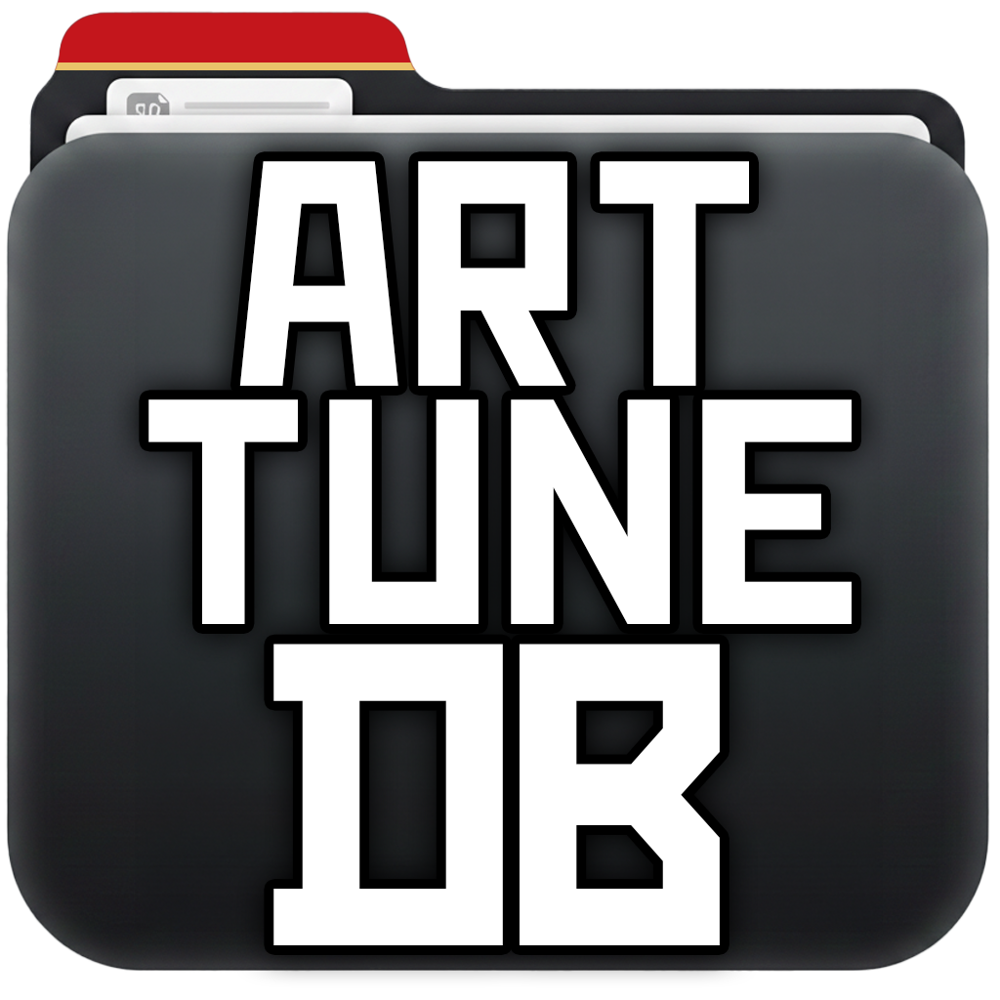
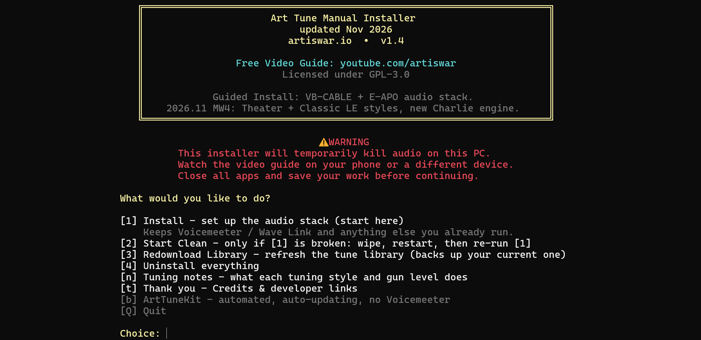
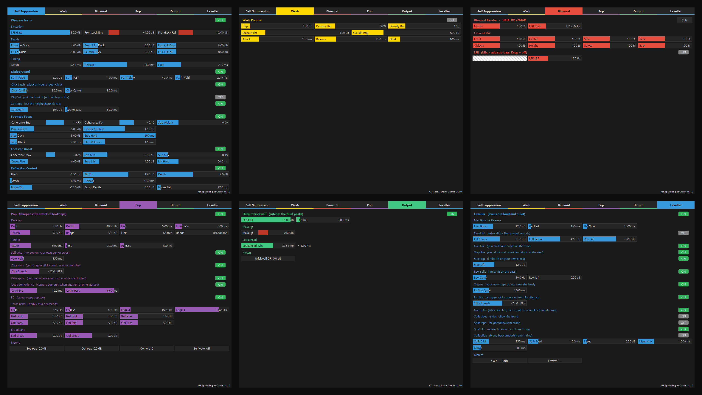
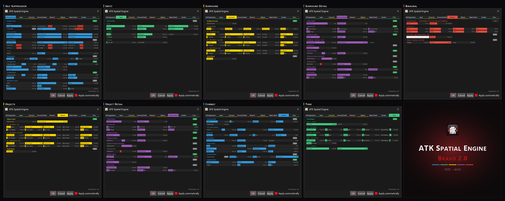

<p align="center">
  
</p>

<p align="center">
  <a href="LICENSE"></a>
  <a href="library/LICENSE"></a>
  
</p>

# ArtTuneDB

Free, open-access database of game audio EQ profiles, HeSuVi configurations, and HRIR files.

See also: [LEQ Control Panel](https://github.com/ArtIsWar/LEQControlPanel) - companion app for managing LEQ state and release time on Art Tune devices.

Check out [youtube.com/artiswar](https://youtube.com/artiswar) for the latest audio guides.

<p align="center">
  
</p>

## Requirements

- Windows 10 or 11 (x64 only -- ARM64 not supported)
- **Windows PowerShell 5.1.** PowerShell 7 is not supported and the installer will refuse to run under it. Setup needs BITS, AppX and PnP components that PowerShell 7 cannot load. Open "Windows PowerShell", not "PowerShell 7" or "Terminal" set to pwsh
- Administrator privileges (required for audio driver and registry operations)
- Internet connection (the installer downloads the audio tools and the tune library)

## Install

Open an **elevated** (Run as Administrator) **Windows PowerShell** window and run:

```powershell
irm artiswar.io/tools/ArtTuneGuided | iex
```

Or run locally:

```powershell
powershell -ExecutionPolicy Bypass -File Install-ArtTune.ps1
```

The main menu offers:

| Option | What it does |
|--------|--------------|
| `[1] Install` | Sets up the audio stack. Start here. Keeps Voicemeeter, Wave Link and anything else you already run |
| `[2] Start Clean` | Only if `[1]` is broken. Wipes, restarts, then you re-run `[1]` |
| `[3] Redownload Library` | Refreshes the tune library. Backs up your current one first |
| `[4] Uninstall everything` | Removes the installed components. Prompts for a restart |
| `[n] Tuning notes` | Opens the tuning notes: what every tuning style and Self Gun Level does, and which file to use |
| `[t] Thank you` | Credits and developer links |
| `[b] ArtTuneKit` | Opens the page for the automated, auto-updating app |
| `[Q] Quit` | Exit |

The script does **not** configure Equalizer APO routing, Voicemeeter routing, LEQ, or pick a profile for you. That part is manual, and the [video guide](https://youtube.com/artiswar) walks through it.

## What the installer does

`[1] Install` runs nine steps:

1. **VB-CABLE** - the virtual audio cable the whole chain routes through
2. **Voicemeeter** - only when you need it. Skipped if you already run Elgato Wave Link or a paid Voicemeeter edition, so your existing mixer is left alone
3. **ReaPlugs** - the VST host and effects the tunes use
4. **Audio endpoints** - names and icons for the three devices below. Setup does not set the channel formats; that is a manual step covered in the [video guide](https://youtube.com/artiswar)
5. **Equalizer APO**, then the tune library, fetched automatically
6. **HeSuVi** - virtual surround via HRIR convolution
7. **HRIR files**, then a starter `config.txt`
8. **JSFX plugins** and the **ATK Spatial Engine** VST DLLs (Bravo and Charlie)
9. **LEQ Control Panel**

### Audio endpoints

VB-CABLE provides three endpoints, renamed and given icons during setup:

| Endpoint | Role |
|----------|------|
| **Art Tune** | 8-channel render. Used by every tune up to BO7 V4 |
| **Art Tune +** | 16-channel render. Used by BO7 V5 and MW4 |
| **Art Tune Unified Output** | Capture. What your own audio app records from |

Select **Art Tune** or **Art Tune +** as the output device in game, matching the tune you are running.

**For a 16-channel tune (BO7 V5, MW4), disable the regular Art Tune device in Windows.** The two Art Tune devices cannot both be enabled while you use one of these tunes. Press Win+R, type `mmsys.cpl` to open the Sound control panel, right-click **Art Tune** on the Playback tab and choose **Disable**. Leave **Art Tune +** alone.

When setup installs Voicemeeter Standard, its two endpoints are renamed as well -- **Voicemeeter Input** becomes **Normal Audio** and **Voicemeeter Out B1** becomes **Virtual Mix**, so they match the names the game settings pages ask for. Banana and Potato are left alone, as is any mixer you chose to keep instead of Voicemeeter.

### The tune library

The library is downloaded and extracted for you during step 5, and `[3] Redownload Library` refreshes it later. There is no manual download-and-drag step.

Releases are also published on the [Releases](https://github.com/ArtIsWar/ArtTuneDB/releases) page if you want to inspect one. The release zip has its payload at the zip root -- the game folders, `jsfx/`, `vst/` and `version.txt` sit directly inside it, with no wrapping `library/` folder.

## The ArtTuneDB folder

Setup creates `C:\Program Files\EqualizerAPO\config\ArtTuneDB\` and a desktop shortcut to it:

| Item | Purpose |
|------|---------|
| `ArtIsWar.url` | Opens artiswar.io |
| `ArtTuneDB.url` | Opens the ArtTuneDB GitHub |
| `E-APO Configuration Editor.lnk` | Opens the Equalizer APO Configuration Editor |
| `LEQ Control Panel.lnk` | Launches LEQ Control Panel |
| `README.txt` | Quick reference for the folder contents |
| `boost.txt` | Optional output boost. A single `Preamp` line, included last on every chain so it acts as a true output gain. Ships seeded at `0 dB`, which is off. Setup writes it once and never overwrites it, so your value survives later runs |
| `library\` | The tune library |

## Library structure

The library is organised by game, then by **version** (`V0`, `V1`, `V3`...). Versions are not game seasons: a tune is a tune, and the numbering no longer pretends to track a season.

```
library/
  BF6_SETTINGS.md        Battlefield 6 in-game audio settings
  COD_SETTINGS.md        Call of Duty in-game audio settings (BO6/BO7/MW4/Warzone)
  TUNING_NOTES.md        Every tuning style, gun level and HRIR head, described
  changelog.txt          What changed in each library release
  version.txt            Release stamp
  BF6/        V0  V1
  BO6/        V6
  BO7/        V0  V3  V4 (super beta)  V5
  MW4/        V1
  PS5-BO6/    V6
  jsfx/                  ATK JSFX plugins
  vst/                   ATK Spatial Engine VST DLLs (Bravo, Charlie)
  measurements/          Headphone measurements for models not on squig.link
```

[`library/TUNING_NOTES.md`](library/TUNING_NOTES.md) describes every tuning style in the library in full. The sections below are the short version.

A typical game/version folder, using BO7 V3:

```
library/BO7/V3/
  BO7_V3.lnk                        HeSuVi preset shortcut
  BO7_V3_pre.txt                    Pre-HeSuVi processing (7.1 channel)
  BO7_V3_post.txt                   Post-HeSuVi processing (stereo)
  BO7_Target_V3.txt                 Target curve for squig.link
  LEQ - Release Time 2 (Insta).txt  Recommended LEQ release time
  Edit E-APO Config.lnk             Opens the E-APO Configuration Editor
  GadgetryTech SquigLink.url        Opens gadgetrytech.squig.link
  eq/
    Flat_EQ.txt                     Fallback EQ, target only, no headphone correction
    (save your own squig.link EQ here)
```

| File | Purpose |
|------|---------|
| `*.lnk` | HeSuVi preset shortcut. Launch it to load the matching HeSuVi profile |
| `*_pre.txt` | Pre-HeSuVi processing chain (7.1 channel). Loaded before HeSuVi in `config.txt` |
| `*_post.txt` | Post-HeSuVi processing chain (stereo shaping). Loaded at the very end |
| `*_Target_*.txt` | Target curve. Upload to squig.link to generate a headphone-specific EQ |
| `LEQ - *.txt` | A note giving the recommended LEQ setting for this tune |
| `eq/` | Your headphone EQ files. Save squig.link Auto EQ results here |
| `eq/Flat_EQ.txt` | Fallback that applies the target with no headphone-specific correction |

`Flat_EQ.txt` is shared across every game and version. The old per-game `TargetOnly_*.txt` files are retired.

The `measurements/` folder holds frequency response data for headphones not widely available on squig.link. Upload one alongside a target curve to generate a matched EQ for an unlisted model.

## MW4 V1: 16-channel tunes

MW4 V1 runs on **ATK Spatial Engine Charlie**, a new engine built from the BO7 V5 work. Like V5 it is 16-channel on the **Art Tune +** endpoint: no HeSuVi stage, no `_pre`/`_post` pair and no LEQ. You point one `Include:` line at one config file.

What you hear first is what happens when you fire. The world no longer drops out: only the front, where your gun sits, comes down with your shots, so footsteps and everything around you stay present.

MW4 V1 is built for Warzone and DMZ. It works in multiplayer, but the Ninja perk and the constant chaos there make it less consistent.

It ships 60 configs: six tuning styles, each at five Self Gun Levels, each for two HRIR heads. Start with **Theater Clear** at **Ultra Low** on the KU100 head: `MW4_V1_16ch_TheaterClear-UltraLoGun_HRIR-KU100.txt`.

| Style | Character |
|-------|-----------|
| **Theater Clear** (default) | The game's own mix with footsteps brought forward. Quiet moments stay quiet, far sounds stay far, and the deep bass is held back so steps sit in a cleaner band. The footstep push lets go of each step gently |
| **Theater Clear+** | The sharper Theater Clear: footsteps are pushed about 3 to 4 dB harder, with a fast, hard edge. Other sharp sounds jump out too, and rapid gunfire can flutter |
| **Classic LE** | The original Loudness Equalization feel, rebuilt as our own leveller |
| **Classic LE+** | Classic LE with footsteps pushed harder. Every step's attack stands out about 2 to 3 dB more; the room, your own steps and your gun sit about 3 dB lower |
| **Classic LE Raw** | Classic LE with nothing working on the world. Room tails, explosions and your own shot's echo come through as the game mixed them |
| **Classic LE Raw+** | Raw with Self Gun Levels that each make a real difference: from High down, the echo of your own shots is cut along with your gun |

Each tuning style has a **Self Gun Level** of `UltraLoGun`, `LoGun`, `MedGun`, `HiGun` or `ExtraHiGun`, from your own gun quietest to loudest. Start on Ultra Low. On the Classic LE styles that is the hardest cut, and a long spray can hold the object and top channels down until you let go. Theater's Self Gun Levels are gentler: its Ultra Low takes off about half of what Classic LE's does, and Extra High leaves your gun as the game mixed it.

Each config also comes for two **HRIR heads**, chosen by file name:

| Suffix | Head |
|--------|------|
| `_HRIR-KU100` | D1 KU100. The default |
| `_HRIR-KEMAR` | D2 KEMAR. The head these tunes were tuned on. Try it if sounds do not place right for you, front against back or high against low |

Files are named `MW4_V1_16ch_<Style>-<Level>Gun_HRIR-<Head>.txt`, with the styles spelled `ClassicLE`, `ClassicLEPlus`, `ClassicLERaw`, `ClassicLERawPlus`, `TheaterClear` and `TheaterClearPlus`.

`library/MW4/V1/Choose a 16ch Tune.txt` describes every style and gun level and names the file for each. The files it lists are the KU100 ones; for KEMAR, change `_HRIR-KU100` in the file name to `_HRIR-KEMAR`. MW4 has its own target curve, `MW4_Target_V1.txt`, so generate a separate squig.link EQ for it.

## BO7 V5: 16-channel tunes

BO7 V5 was the first 16-channel release. The ATK Spatial Engine runs the whole chain natively on the **Art Tune +** endpoint, so **there is no HeSuVi stage** and no `_pre`/`_post` pair. You point one `Include:` line at one config file.

V5 ships 40 configs: eight tuning styles, each at five Self Gun Levels. Start with **Classic+** at **Ultra Low**: `BO7_V5_16ch_ClassicPlus-UltraLoGun.txt`.

| Style | Character |
|-------|-----------|
| **Classic+** (default) | Classic with more footstep lift. Distant steps come through louder, close ones are no longer held back |
| **Classic** | Slowest leveller timing, the least audible processing. Closest to the old Loudness Equalization feel |
| **Open** | The least filtered. Built on Balanced, so mid-level sound comes up harder and less bright content is held back |
| **Full** | Combat ducking off, footsteps lifted, full dynamics |
| **Competitive** (experimental) | Maximum footstep detail |
| **Capped** (deprecated) | Full with a hard output clamp. Kept for anyone already using it |
| **Immersive** (deprecated) | Guns tamed deepest. Kept for anyone already using it; Classic covers the same ground |
| **Balanced** (deprecated) | Full's footstep lift with combat control kept on. Kept for anyone already using it; Open replaces it |

Deprecated styles still ship and still work.

Each tuning style has a **Self Gun Level** of `UltraLoGun`, `LoGun`, `MedGun`, `HiGun` or `ExtraHiGun`, controlling how much of your own gunfire stays in the mix. Extra High was called Stock before 2026.11: the sound is the same and only the file name changed, from `-StockGun.txt` to `-ExtraHiGun.txt`. Ultra Low pushes your own gun to the engine's limit; the room reflection after a shot is not ducked at that tier, so if the ring-out distracts you, use Low. Files are named `BO7_V5_16ch_<Style>-<Level>Gun.txt`, with Classic+ spelled `ClassicPlus`.

`library/BO7/V5/Choose a 16ch Tune.txt` describes every combination and names the exact file to use. Read that before picking.

BO7 V5 carries no LEQ note because the 16-channel path does not use Loudness Equalization.

## BO7 V4 - SUPER BETA, EXPERIMENTAL

> **BO7 V4 is SUPER BETA and EXPERIMENTAL. It is not a finished tune, and it is not the recommended way to play.**

V4 ships so people who want to experiment can try it and send feedback. Treat it as a work in progress:

- Its pre-HeSuVi chain dates from **October 2025** and predates all of the V5 work
- There is **no post chain** -- `BO7_V4_post.txt` is an intentional empty placeholder
- **LEQ is disabled** for this profile (`LEQ - OFF.txt`)
- It runs the older **Bravo v1.0.2** VST, not the Bravo v2.0.0 engine that drives V5

For the current BO7 tune, use **V5** (16-channel, `Art Tune +`) or **V3** (8-channel, `Art Tune`).

## BO7 V3 tuning styles

BO7 V3 ships four pre-HeSuVi tuning styles. All four use the same Spatial Engine and Stereo Enhancer, tuned differently:

| Tuning style | File | Description |
|-----------|------|-------------|
| **Competitive** (default) | `BO7_V3_pre.txt` | Aggressive suppression, heavy noise removal, maximum footstep separation |
| **Clean** | `BO7_V3_pre_clean.txt` | Lighter processing, more natural spatial image |
| **Streamer** | `BO7_V3_pre_streamer.txt` | Gun stays punchy, environment has presence |
| **Ultra** (experimental) | `BO7_V3_pre_ultra.txt` | Maximum footstep extraction, everything cranked |

Swap the pre file path in your `config.txt` to change tuning style.

## Configuration

Setup writes a starter `config.txt` to `C:\Program Files\EqualizerAPO\config\config.txt`, with placeholder Include paths pointing into `ArtTuneDB\library\`. Open it in the E-APO Configuration Editor and point each line at the game and version you want.

**Both chains are written live.** Each is scoped to its own output device with a `Device:` line carrying that endpoint's GUID, so Equalizer APO applies whichever chain matches the device you are actually playing through:

| Device line | Chain |
|-------------|-------|
| `Device: Art Tune VB-Audio Virtual Cable {guid}` | 8-channel, uses HeSuVi |
| `Device: Art Tune + VB-Audio Virtual Cable {guid}` | 16-channel, no HeSuVi, needs the bundled VST |

Do not comment either one out. Which chain runs is decided by the output device, not by editing `config.txt`. For a 16-channel tune, the regular **Art Tune** device also has to be disabled in Windows: see [Audio endpoints](#audio-endpoints).

The 16-channel section is written only when both endpoints resolved during setup. If the **Art Tune +** endpoint was missing, you get an 8-channel-only `config.txt`; re-run setup to add the other chain.

### 8-channel tunes (everything up to BO7 V4)

Order matters: pre, HeSuVi, EQ, post, boost.

```
# ---- 8ch profile (Art Tune) ----
Device: Art Tune VB-Audio Virtual Cable {guid}
# PRE HESUVI
Include: ArtTuneDB\library\BO7\V3\BO7_V3_pre.txt
# DO NOT REMOVE HESUVI #
Include: HeSuVi\hesuvi.txt
# EQ
Include: ArtTuneDB\library\BO7\V3\eq\YourHeadphone_BO7_V3.txt
# POST HESUVI
Include: ArtTuneDB\library\BO7\V3\BO7_V3_post.txt
# OUTPUT BOOST
Include: ArtTuneDB\boost.txt
```

Do not remove the HeSuVi comment or its include line.

### 16-channel tunes (BO7 V5, MW4)

One tune file, no HeSuVi:

```
# ---- 16ch profile (Art Tune +) ----
Device: Art Tune + VB-Audio Virtual Cable {guid}
# 16ch TUNE
Include: ArtTuneDB\library\BO7\V5\BO7_V5_16ch_ClassicPlus-UltraLoGun.txt
# EQ
Include: ArtTuneDB\library\BO7\V5\eq\YourHeadphone_BO7_V5.txt
# OUTPUT BOOST
Include: ArtTuneDB\boost.txt
```

For MW4, the same two lines point into `MW4\V1`:

```
Include: ArtTuneDB\library\MW4\V1\MW4_V1_16ch_TheaterClear-UltraLoGun_HRIR-KU100.txt
Include: ArtTuneDB\library\MW4\V1\eq\YourHeadphone_MW4_V1.txt
```

Only use files with `_16ch_` in the name on the tune line.

### Output boost

`ArtTuneDB\boost.txt` is included **last on both chains**, so it lands after all other processing and acts as a true output gain. It is one file shared by both. Set your dB there; it ships at `0 dB`, which is off. Equalizer APO reloads it live, so no restart is needed.

## Headphone EQ

To generate an EQ matched to your headphone:

1. Open `GadgetryTech SquigLink.url` in the game/version folder
2. Upload the target file (for example `BF6_Target_V0.txt`) in the **EQ** tab on the left
3. Search for your headset or IEM
   - Not listed? Check the `measurements/` folder for your model and upload that alongside the target
   - Still nothing? Use `eq/Flat_EQ.txt` directly. It applies the target with no headphone correction. Better than no EQ, but not as accurate as a matched profile
4. Hit **Auto EQ**
5. Save the result as `YourHeadphone_BO7_V3.txt`, matching the game and version
6. Put the file in that version's `eq/` subfolder

## In-game settings

Each game needs specific in-game audio settings for the chain to work. Reference files live in the library root:

| File | Covers |
|------|--------|
| `library/BF6_SETTINGS.md` | Battlefield 6 -- Volume Mixer routing, 7.1 Surround, volume levels, audio mix |
| `library/COD_SETTINGS.md` | MW4, Black Ops 7, Black Ops 6, Warzone: device selection (**Art Tune** for V0-V4, **Art Tune +** for BO7 V5 and MW4), Speaker Output on **Windows Default**, Enhanced Headphone Mode off |

Apply these before playing. The wrong output device, the wrong Speaker Output setting, or Enhanced Headphone Mode left on will bypass or break the chain.

The Speaker Output value differs by game, so use the file rather than assuming. Battlefield 6 wants **7.1 Surround**. Call of Duty wants **Windows Default**, which lets the game follow the format of whichever endpoint it is playing to -- 8-channel on **Art Tune**, 16-channel on **Art Tune +**. Forcing a fixed layout there overrides that and breaks the routing.

## HRIR files

The installer downloads two HRIR presets, each at both sample rates, into `C:\Program Files\EqualizerAPO\config\HeSuVi\hrir\`:

| Preset | Sample rates |
|--------|--------------|
| `EAC_Default.wav` | 48 kHz and 44.1 kHz |
| `EAC_Refined.wav` | 48 kHz and 44.1 kHz |

The `hrir/` folder in this repo holds `EAC_Default.wav` at both rates for reference. To add it by hand, copy the folder contents into the HeSuVi `hrir\` directory above.

## JSFX and VST plugins

Setup installs both plugin sets in step 8. There is no separate menu item for them.

**JSFX**, installed to `C:\Program Files\VSTPlugins\ReaPlugs\JS\Effects\ArtTuneKit\`:

- **ATK Spatial Engine** (`atk_spatial_engine.jsfx`) -- processes raw 7.1 game audio before HeSuVi. Separates footsteps from gunfire and ambience across all surround channels, suppresses your own sounds, and adapts to the scene. 59 parameters
- **ATK Stereo Spatial Enhancer** (`atk_stereo_spatial_enhancer.jsfx`) -- processes stereo output after HeSuVi. Cleans up crossfeed bleed from HRIR convolution, keeps bass centred, widens the field. 7 parameters

**VST**, installed to `C:\Program Files\VSTPlugins\ArtTuneKit\`:

- **ATK Spatial Engine Bravo** (`atk_spatial_engine_bravo_v1.0.2.dll`, `atk_spatial_engine_bravo_v2_0_0.dll`): the native engine for BO7. v2.0.0 drives the 16-channel BO7 V5 path
- **ATK Spatial Engine Charlie** (`atk_spatial_engine_charlie_v1_1_0.dll`): the engine behind MW4 V1. 16-channel, with its own leveller in place of Loudness Equalization and the binaural render built in

BO7 V3 needs the JSFX plugins. BO7 V4 and V5 need Bravo. MW4 needs Charlie.

**ATK Spatial Engine Charlie 1.1** (VST): every panel, the engine behind MW4 V1:

<p align="center">
  
</p>

**ATK Spatial Engine Bravo 2.0** (VST) -- every panel, the engine behind BO7 V5:

<p align="center">
  
</p>

**ATK Stereo Spatial Enhancer** (JSFX) -- the post-HeSuVi stereo stage used by BO7 V3:

<p align="center">
  
</p>

## Release naming

Releases use CalVer with a label. They track library work, not game seasons.

**Format:** `YYYY.MM[.patch]-Label`

**Examples:**

- `2026.02-InitialRelease`
- `2026.04-AvalonEraRevamp`
- `2026.04.1-AvalonEraRevampV2` - patch release on the same label
- `2026.07-Overhaul`
- `2026.07.1-Overhaul`
- `2026.09-V5Styles`
- `2026.11-MW4` - current

The stamp for the shipped library is in `library/version.txt`, and `library/changelog.txt` records what changed in each one.

## Third-Party Software

| Software | Purpose | License | Link |
|----------|---------|---------|------|
| [Equalizer APO](https://sourceforge.net/projects/equalizerapo/) | System-wide audio processing engine | GPL-2.0 | [SourceForge](https://sourceforge.net/projects/equalizerapo/) |
| [HeSuVi](https://sourceforge.net/projects/hesuvi/) | Virtual surround (HRIR convolution) for headphones | GPL-2.0 | [SourceForge](https://sourceforge.net/projects/hesuvi/) |
| [ReaPlugs](https://www.reaper.fm/reaplugs/) | VST audio plugins (compressor, EQ, limiter) | Freeware (REAPER license) | [reaper.fm](https://www.reaper.fm/reaplugs/) |
| [VB-CABLE](https://vb-audio.com/Cable/) | Virtual audio cable for routing | Donationware | [vb-audio.com](https://vb-audio.com/Cable/) |
| [Voicemeeter](https://vb-audio.com/Voicemeeter/) | Virtual audio mixer, installed only when needed | Donationware | [vb-audio.com](https://vb-audio.com/Voicemeeter/) |
| [LEQ Control Panel](https://github.com/ArtIsWar/LEQControlPanel) | Manages LEQ state and release time on Art Tune devices | GPL-3.0 | [GitHub](https://github.com/ArtIsWar/LEQControlPanel) |
| ATK Spatial Engine Bravo and Charlie (VST) | Native spatial audio processing engines (8ch / 16ch) | Proprietary (binary-only) | [LICENSE](library/vst/LICENSE) |

These tools are downloaded during installation and are subject to their own license terms.
ArtTuneDB does not bundle or redistribute the third-party tools -- they are fetched from their official sources at install time.

Earlier versions of the stack used VB-Audio Hi-Fi Cable. It has been retired: setup now removes it and installs VB-CABLE instead.

### HRIR Attribution

The **EAC_Default.wav** HRIR preset was generated using [Individualized HRTF Synthesis](https://github.com/davircarvalho/Individualized_HRTF_Synthesis) by Davi Carvalho (Federal University of Santa Maria, Brazil). The synthesis tool is licensed under GPL-3.0. The generated HRIR output (`.wav` file) is redistributed as data, not as a derivative of the tool's source code.

## License

Copyright (C) 2026 ArtIsWar, LLC.

This repository carries several licences. Coverage by path:

| Path | Licence |
|------|---------|
| `powershell/` | [GPL-3.0](LICENSE) |
| `library/` | [CC BY-NC-SA 4.0](library/LICENSE), except the two paths below |
| `library/jsfx/` | [MIT](library/jsfx/LICENSE) |
| `library/vst/` | Proprietary, binary-only. See [library/vst/LICENSE](library/vst/LICENSE) |
| `jsfx/` | [MIT](jsfx/LICENSE) |
| `Assets/` | Screenshots and icons, (C) 2026 ArtIsWar, LLC |
| `hrir/` | Generated output. See [HRIR Attribution](#hrir-attribution) |
| Root documentation | (C) 2026 ArtIsWar, LLC |

See each LICENSE file for full terms.
